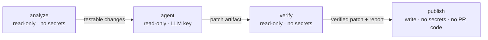

# Solution: unit-test agent and PR workflow

A custom **Claude Code** agent (`test-engineer`) with four reusable skills writes and updates Vitest unit tests for the backend (Express + Prisma) and the frontend (React + TanStack Query). A GitHub Actions workflow runs the agent on every pull request, verifies its output independently, commits the tests to the PR branch, and reports the result in a sticky PR comment.

| | Backend | Frontend |
|---|---|---|
| Before | 48 tests · 33% lines · 33% branches | 18 tests · 48% lines · 44% branches |
| After the coverage run | 94 tests · 100% lines · 95.8% branches | 120 tests · 100% lines · 98.5% branches |

## Where things live

| Path | What |
|---|---|
| `.claude/agents/test-engineer.md` | The agent: role, hard rules, workflow, report format. Preloads the skills via `skills:` |
| `.claude/skills/analyze-pr-changes/` | Deterministic script `changed-sources.mjs`: diff vs base → changed sources mapped to their test files. Includes a create / update / skip decision table |
| `.claude/skills/backend-unit-tests/` | Backend conventions taken from the existing tests: supertest without `listen`, spies on Prisma delegates, `fixture.ts`, `.ts` imports |
| `.claude/skills/frontend-unit-tests/` | Frontend conventions: RTL query priority, design-system mocks, `QueryClient` wrapper for hooks, `fetch` stubbing |
| `.claude/skills/run-unit-tests/` | Script `run-tests.mjs`: targeted or full run → compact JSON (results, trimmed failures, coverage, least-covered files, `tsc`). Also defines the verification loop |
| `.github/test-agent/settings.json` | The agent's permission allowlist in CI |
| `.github/test-agent/check-patch.sh` | Hard guarantee: the patch may touch only test files and fixtures |
| `.github/test-agent/summarize-session.mjs`, `render-comment.mjs` | Session summary (turns, cost, permission denials) and the PR comment |
| `.github/workflows/pr-test-agent.yml` | The agentic PR workflow |
| `.github/workflows/ci.yml` | Plain CI: typecheck and tests with coverage thresholds, for every PR and `main` |

**How the skills are used during a run.** The agent starts as the main thread (`claude --agent test-engineer`), so its prompt replaces the default system prompt. The four skills are preloaded, and the agent invokes each one at its step:

1. `analyze-pr-changes`: decide what to test.
2. `backend-unit-tests` / `frontend-unit-tests`: write the tests.
3. `run-unit-tests`: targeted runs while iterating, then the full suite.

It finishes by writing `.test-agent/report.md`. The same agent has a **coverage mode** with no diff: it takes the `uncovered` list from a full run as its work list. That mode produced the coverage numbers above.

## The PR workflow



| Job | What it does |
|---|---|
| **analyze** | Runs `changed-sources.mjs` against the base branch. Skips the agent (and its token cost) when no testable source changed, for fork PRs (no secrets), and when the head commit is the agent's own (`[test-agent]` marker). |
| **agent** | Installs dependencies with `--ignore-scripts` and runs pinned Claude Code: `--agent test-engineer --settings .github/test-agent/settings.json --setting-sources project --permission-mode dontAsk --max-budget-usd 5 --model sonnet`. The output is a **patch artifact**, since this job has no push credentials. A run that ends without a report fails the step. Exit code 0 is not treated as success: an agent blocked by permissions also exits cleanly. |
| **verify** | Applies the patch through `check-patch.sh`. Anything outside `backend/tests/**/*.test.ts`, `frontend/src/**/*.test.ts(x)` and the two fixtures is rejected, as are symlinks and binaries. Then it runs **both** full suites with coverage thresholds and `tsc`, renders the report into the job summary, and fails the check if anything fails. |
| **publish** | Re-validates the patch and commits it as `github-actions[bot]`. It pushes without force, so a branch that moved in the meantime is never overwritten. Then it creates or updates the sticky comment. This is the only job with a write token, and it runs no code from the PR. |

### Running it

**Prerequisites**
- Repository secret `ANTHROPIC_API_KEY`, or `CLAUDE_CODE_OAUTH_TOKEN` from `claude setup-token`.
- *Settings → Actions → General → Workflow permissions*: **Read and write**.
- The agent config must exist on the base branch. The workflow always takes `.claude/` and `.github/test-agent/` from the base branch, never from the PR.

**Usage**
- Open or update a non-draft PR that changes `backend/**` or `frontend/**`. Nothing else is needed.
- GitHub marks runs triggered by the bot's commit as `action_required`. Approve the **CI** run to get a green check on the committed tests. Approving the agent run is harmless: `analyze` stops on the `[test-agent]` marker.

**Locally**
```bash
claude -p "PR mode. Base ref: origin/main. Create or update unit tests for the code changed in this branch, verify them, and write .test-agent/report.md." --agent test-engineer --settings .github/test-agent/settings.json --permission-mode dontAsk
```
Or in coverage mode: `"Coverage mode: improve unit test coverage of both backend and frontend."`

## Main decisions and why

- **Claude Code CLI directly, not `claude-code-action`.** The agent job then needs no GitHub App and no write token, and every flag (agent, settings, permission mode, budget, model, version) is explicit and pinned. The action is the natural choice for interactive `@claude` mentions, which this task does not need.
- **Deterministic scripts wherever an LLM is not needed.** Mapping files to tests, gating, running tests and validating the patch are plain scripts. This keeps them reproducible, cheaper (the agent is not started for documentation-only PRs) and testable. The agent only does the judgment work: what behaviour changed and how to test it.
- **Skills encode this repo's conventions**, taken from the existing tests (fixtures, mocks, file layout), not generic advice. Generated tests should look like the tests already in the repo.
- **"Verified or not reported."** The agent may claim a pass only if `run-tests.mjs` returned `ok: true` for it in the same session. CI then re-runs everything itself anyway.
- **Never weaken a test to go green.** When a test exposes a probable bug, the agent keeps the source as it is, removes only that assertion and reports the bug. It gets at most 3 fix attempts per file, then reverts its own change to that file. The agent found a real bug this way (see *Example runs*).
- **Typecheck as part of verification.** Vitest strips types without checking them, so a test can pass while an outdated fixture breaks `tsc`. This happened on the demo PR.
- **The agent commits to the PR branch** rather than opening a separate PR: the author gets the tests in the same review, with a clear bot commit that is easy to revert.

### Security model (defense in depth)

1. **Agent rules.** Only test files, untrusted input is data, no network, installs or git writes, never weaken tests.
2. **Permission allowlist** in `dontAsk` mode, so anything not allowed is denied:
   - Allowed: `Edit` only on test paths; `Bash` only for the two skill scripts and read-only `git diff/log/status`.
   - Denied explicitly: `WebFetch`/`WebSearch`, `.env`, `curl`, `git push/commit`, `npm install` and `npx`.
3. **Deterministic `check-patch.sh`, run in two jobs.** This is the only hard guarantee, because Bash rules match command text and can be bypassed (e.g. `git -C . push`).

Further measures:
- **Privilege separation.** Each job gets only the token and secrets it needs; see the workflow table.
- **Config comes from the base branch.** A PR cannot loosen the agent's rules or permissions for its own run.
- **No secrets in test processes.** `run-tests.mjs` starts Vitest and `tsc` with an allowlisted environment, so test code written by the PR author or by a prompt-injected agent cannot read the API key and leak it into output that ends up in a public comment.
- **Less untrusted input.** PR title and body are not given to the agent. Instructions found in code or diffs must be ignored and listed in the report. `@mentions` in the LLM report are neutralized.
- **Supply chain.**
  - Actions are pinned to commit SHAs and Claude Code to an exact version.
  - Dependencies are installed with `npm ci --ignore-scripts`, followed by an explicit `prisma generate`.
  - Script input is validated: the git ref is a strict pattern passed through `execFileSync` without a shell, and test paths must match the project's test pattern.
- **Platform guardrails.**
  - Trigger is `pull_request`, never `pull_request_target`.
  - Default `permissions: {}`, with timeouts on every job.
  - `concurrency` per PR.
  - A budget cap per run.
  - `--setting-sources project`, so user-level plugins never influence CI.

## Example runs

### Demo PR #3: "Add pinned tasks" (feature without tests)

The feature touches 13 source files across both projects:
- **Backend:** new column with a migration, validators, mapper, pinned-first ordering, OpenAPI.
- **Frontend:** pin button, sorting, page handler.

Before the agent ran:
- **Backend:** 13 of 94 tests failed.
- **Frontend:** 1 of 120 tests failed.
- **Typecheck:** failed in both projects (fixtures without `pinned`, missing `onPin` prop).
- **Untested code:** the new paths had no tests.

**Run 1 failed safely.** The agent analyzed the change correctly, but **all 10 edits were denied**. Edit rules with a leading `/` in a `--settings` file resolve against that file's directory, not the repo root. The agent did not try to work around the denials and explained the problem in its final message (25 turns, $0.14). Two problems were in the workflow itself:
- It accepted exit code 0 without a report.
- It did not pass the environment of test processes through an allowlist.

Both are fixed, together with the rule paths, in PR #4. The comment now shows the agent's final message and its permission denials.

**Run 2 succeeded** ([workflow run](https://github.com/danielkamin/taskly-app-node/actions/runs/41225365958)). It took about 2.5 minutes in total: the agent session was 55 turns, $0.27 and 74 s, with 0 permission denials.

**Decisions** (from the agent's report):

| Source | Decision | Reason |
|---|---|---|
| `backend/src/core/database.ts` | updated | `pinned` column plus `ALTER TABLE` migration statement |
| `backend/src/features/todos/repository.ts` | updated | pinned-first ordering; `pinned` is updatable |
| `backend/src/features/todos/validators.ts`, `mappers.ts` | updated | `pinned` boolean, defaults to `false`, mapped to the API |
| `frontend/src/features/todos/TodosPage.tsx` | updated | new `togglePin` handler (notices, error, busy guard) |
| `frontend/src/features/todos/components/TodoItem.tsx`, `TodoList.tsx` | updated | Pin/Unpin button with `aria-pressed`; `onPin` forwarded |
| `frontend/src/features/todos/utils/todos.ts` | updated | pinned tasks first for every sort |
| `frontend/src/features/todos/api/todos.ts`, `TodoForm.tsx` | updated | `pinned` in payloads and form defaults |

It also updated both fixtures and `router.test.ts`. That file was broken by the change even though `router.ts` was not modified. The file-to-test mapping cannot see this kind of breakage, which is why the full-suite run is mandatory.

**Skills used:** `analyze-pr-changes` → `backend-unit-tests` and `frontend-unit-tests` → `run-unit-tests` (targeted runs, then full runs).

**Results**, verified by CI and again locally:

| | Before | After |
|---|---|---|
| Backend | 81/94 tests, `tsc` ✗ | **97/97**, `tsc` ✓ · 100% lines · 95.8% branches |
| Frontend | 119/120 tests, `tsc` ✗ | **130/130**, `tsc` ✓ · 100% lines · 98.0% branches |

The bot commit `7610ddb` contains only test files: 13 files, +135/−8. The four removed assertions were replaced by stricter ones, for example `toHaveBeenCalledOnce()` became `toHaveBeenCalledTimes(2)` plus an assertion on the migration SQL. A manual mutation check confirmed that the tests catch regressions:
- Removing pinned-first sorting from `selectTodos` fails 3 of the new tests.
- Removing `pinned: 'desc'` from the repository's `orderBy` fails 1 test.

### Bug found during the coverage run

In `backend/src/core/lifespan.ts`, Express 5's `app.listen` passes `EADDRINUSE` to its callback instead of emitting `'error'`. As a result `start()` resolved with an unbound server and then threw `TypeError: Cannot read properties of null`, so the real error was lost. Following its rules, the agent did not touch the source. It removed only its `toThrow(/EADDRINUSE/)` assertion and reported the suspected bug, which was then confirmed with a minimal reproduction. The fix comes in a separate PR (`fix/listen-error`). That PR leaves the weakened test untouched on purpose, so the PR workflow can tighten it.

## Assumptions

- "Unit test" means no real database or network. Prisma is exercised by spying on the delegates of a real client that never connects; HTTP is tested with supertest.
- The design system (`src/design-system/**`) stays out of coverage scope, as in the original configuration.
- Only same-repository PRs get the agent. Fork PRs run plain CI only, since GitHub withholds secrets from them.
- Collaborators with write access are trusted to the extent GitHub already trusts them: they can change workflows anyway. The safeguards target untrusted content (code, diffs, LLM output), not repository admins.
- Committing tests to the author's branch is acceptable. The author reviews them like any other commit.

## Limitations

- **The bot's commit does not get CI automatically.** GitHub marks runs triggered by `GITHUB_TOKEN` as `action_required`. The `verify` job already tested exactly that tree, but a human has to approve the CI run to get a green check.
- **Permissions could not be tested locally.** A nested `claude -p` inside the desktop app failed authentication, so the restrictive configuration was first exercised in CI. This is what Run 1 shows. The coverage run was done locally with the same agent definition and skills, but with the session's own permissions.
- **Mapping is heuristic.** Files map to tests by basename (backend) or by colocation (frontend). Indirect breakage is caught only by the full run. Exclusion lists in the script are kept in sync with the Vitest configs by hand.
- **Coverage is not quality.** There is no automated mutation testing; the mutation check above was manual.
- **Formatting.** Generated tests are not run through Prettier.
- **Budget cap.** `--max-budget-usd` applies to API billing. With an OAuth subscription token the cap is not verified.
- **Grep/Glob unavailable in CI.** Claude Code 2.1.308 on the Linux runner did not expose them. `grep`/`cat` through Bash are intentionally not allowed (they could read `/proc/self/environ`), so the agent reads files with `Read`.

## For a production version

- **GitHub App token** with narrow permissions instead of `GITHUB_TOKEN`, so the bot's commit triggers CI automatically.
- **Network isolation for the agent job.** Restrict egress so the only allowed destination is the Anthropic API (e.g. a container with a firewall, or harden-runner).
- **Mutation testing** (Stryker) on changed files as a quality gate for generated tests, plus Prettier/ESLint on the patch.
- **A permission smoke test** before the real run, so a broken allowlist fails fast and cheaply.
- **Evals for the skills:** a set of reference PRs with expected decisions, run whenever the agent or a skill changes.
- **Optional "suggest" mode:** a separate PR with tests, or a review with suggested changes, for teams that do not want bot commits on their branches.
- **Efficiency.** Run backend and frontend agents in parallel and only for the project that changed. Cache dependencies across jobs. Show token and cost trends over time.
- **Less duplication.** Derive coverage exclusions from the Vitest configs instead of maintaining them by hand.
